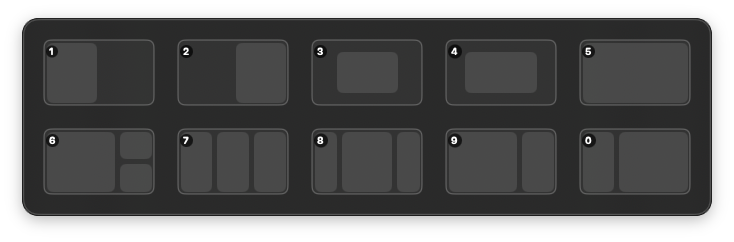
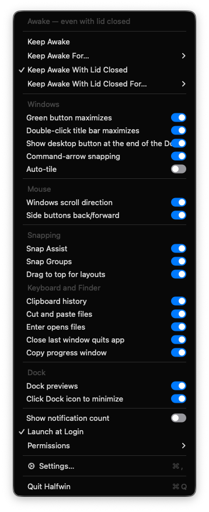

<p align="center">
  
</p>

# Halfwin

**The Windows window habits Mac switchers miss, in one free native app.**

If you came to the Mac from Windows, the small things are what you notice. Edge snapping is limited or missing, depending on your macOS version. There is no layout menu at the top of the screen. Dock icons do not show you the windows behind them. The mouse scrolls the wrong way and the side buttons do nothing. Halfwin puts those habits back. It is a native macOS menu-bar app, and it covers snapping, layouts, mouse behavior, Dock previews, Show desktop, and keeping your Mac awake, so you do not need a stack of separate utilities.

Every optional feature has its own switch in the menu, so you can take only the parts you want.

[Full feature guide](docs/FEATURES.md)

## Snapping and layouts

- Hover at the top center of a display to open the layout menu, or drag a window there to place it. Tiles include Left Half, Right Half, Center, Normal, Maximize, Left + Stack, Thirds, and Command Center.
- Click one part of a multi-part tile, or drop a dragged window on that part. Normal restores the previous frame when Halfwin has one saved.
- Snap Assist offers your other visible windows for the empty parts of a layout. Halfwin remembers the windows in a multi-window layout for the current session.

- Drag a window to a screen edge or corner to preview a placement, then release to snap. The top edge maximizes, the top corners take the outer thirds, the side edges split into halves, the bottom corners are quarters, and the bottom edge selects thirds.
- Portrait screens use their own map: quarter corners, maximize at the top, left and right halves along the bottom, and vertical thirds on the sides.
- Touching full-height or full-width windows glue together after a move or resize, and shared resizing adds a grab bar.
- The green zoom button and a double-click on a title bar toggle maximize and restore. Command-arrow keys step a window through halves, thirds, and quarters. Command-Up maximizes, and Command-Down on a maximized window opens Command Center.

## Dock previews

- Hover over a running app's Dock icon to see its windows. Click a preview to restore and raise that window.
- Windows minimize into their own app's Dock icon. Click the frontmost app's Dock icon to minimize its windows, then click again to restore them.
- With Screen Recording access, previews show real window pictures. Halfwin captures a picture before minimizing, so a minimized window keeps its last one.

## Mouse, Show desktop, and Keep Awake

- Windows scroll direction applies to trackpads and mouse wheels, including horizontal mouse-wheel scrolling.
- Mouse side buttons send Back and Forward in Finder, Safari, Safari Technology Preview, Firefox, Arc, Slack, System Settings, App Store, Music, and Help Viewer.
- A Show desktop button at the end of the Dock moves windows aside on every display, or hides apps if you pick that style. Click it again to bring the windows back.
- Keep Awake holds your Mac awake indefinitely or for 15 minutes, 30 minutes, 1 hour, 2 hours, or 5 hours, plus options that keep it awake with the lid closed (those ask for an administrator password).

## Features



- Drag-to-edge snapping with an eight-position snap map you can change, plus a button to restore the default map.
- A top-center hover layout menu with its own on and off control, a dwell delay, and an adjustable Command Center pane width.
- Snap Assist, window glue, and Snap Groups for paired left and right half windows.
- Dock window previews with an adjustable hover delay and preview size.
- Windows-style scroll direction and mouse side buttons.
- A clipboard history picker on a held Command-V, plus Finder cut, paste, and Enter-to-open behavior.
- Show desktop from the Dock, and Keep Awake with timed options.
- Every optional feature has its own switch in the menu bar menu.

<br clear="right">

## Install

Build from source. Requirements: macOS 14 or later and a Swift 6.3 toolchain (current Xcode or Command Line Tools).

```sh
git clone https://github.com/DHRlabs/Halfwin.git
cd Halfwin
bash Scripts/build.sh
cp -R build/Halfwin.app /Applications/
```

If macOS blocks a downloaded build, open **System Settings > Privacy & Security** and choose **Open Anyway**.

## Requirements and notes

- macOS 14 or later.
- **Accessibility** access is needed for snapping, mouse controls, window actions, the keyboard and Finder features, and Dock previews.
- **Screen Recording** access is needed only for Dock window pictures.
- Grant both from Halfwin's Permissions menu. macOS may also ask to let Halfwin control Finder for its Finder tweaks.
- Halfwin pairs with [Dockside](https://github.com/DHRlabs/dockside), which can host Halfwin's Show desktop button beside the Dock. When Dockside is not hosting it, Halfwin shows its own button instead.

## Credits and license

The drag-to-edge snapping design and geometry are adapted from [Rectangle](https://github.com/rxhanson/Rectangle) by Ryan Hanson (MIT). See [NOTICE](NOTICE) for details.

Halfwin is licensed under the [MIT License](LICENSE).
